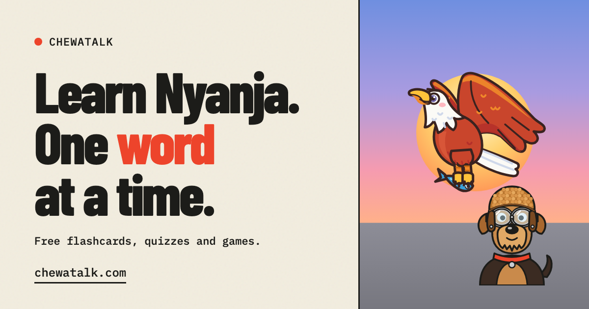

<p align="center">
  <a href="https://chewatalk.com">
    
  </a>
</p>

<h1 align="center">ChewaTalk</h1>

<p align="center">
  <b>Learn Nyanja (Chichewa) one word at a time.</b><br>
  Flashcards, quizzes and a matching game for the Nyanja people actually use.
</p>

<p align="center">
  <a href="https://chewatalk.com"><b>▶ Try it at chewatalk.com</b></a>
</p>

---

## Why

Nyanja is the everyday language of Lusaka and much of Zambia, and closely related to Chichewa in Malawi. Most of what's written down is old, rural, or hard to find, and the modern town Nyanja people actually speak is barely recorded. ChewaTalk is a passion project to make it easy to start learning, and to build up a checked record of the language as it's really used.

## What's in the app

- **Five levels:** First Words, Everyday Vocabulary, Building Sentences, Conversations, and Real-World Fluency. Each one unlocks when you've learned 60% of the one before.
- **Survival kit:** a bonus track for getting by: travel, the market, food, days of the week, and asking someone to slow down.
- **Flashcards:** a 3D deck you flip, then swipe or tap "Got it" or "Again".
- **Quiz:** multiple choice, English → Nyanja and back, with combo bonuses.
- **Match:** pair English and Nyanja tiles against the clock.
- **Phrasebook:** every phrase, searchable, with its source and notes.
- **Mascots:** Nkwazi the fish eagle (named from Zambia's national anthem) and Goggles the aviator dog coach you through the lessons and react to your answers. Now and then they run across the screen.
- XP, a daily streak, sound effects, and a layout that works on phones.

## Translations: never made up

This is the core rule of the project: **no Nyanja is invented or machine-translated.** Every translation comes from a named source, with its page or entry recorded:

| Source | Notes |
| --- | --- |
| *Peace Corps/Zambia PST 1995 Special Lessons: Nyanja* | Kept with its original 1995 spelling, which writes "c" where newer spelling uses "ch" (*cakudya* → *chakudya*). |
| Wikitravel, *Nyanja phrasebook* | Mostly Malawi Chichewa forms, so each of these phrases is flagged for a Lusaka speaker to check. Licensed CC BY-SA 3.0. |

Phrases without a checked translation are kept in the phrasebook and marked as **waiting**. Unclear or suspicious spellings are marked **to check** and left out of quizzes.

**Current coverage:** 81 of 305 phrases in the main course have a translation, plus 72 survival-kit phrases. Translations from a Nyanja speaker, especially for Lusaka town Nyanja, are the most valuable contribution this project can get.

## Repository

```
ChewaTalk/
├── chewatalk-frontend/     The live site (static, no build step)
│   ├── index.html          Page shell, SEO metadata
│   ├── css/style.css       All styling and animation
│   ├── js/app.js           Router and views: home, levels, flashcards, quiz, match, phrasebook
│   ├── js/mascots.js       Nkwazi and Goggles (hand-drawn SVG with moods)
│   ├── js/pets.js          The pets that run across the screen
│   ├── js/fx.js            Confetti, sounds, cursor, scroll effects
│   ├── js/store.js         Progress (XP, streak, learned words)
│   ├── data/vocab.json     Generated vocabulary. Don't edit by hand
│   ├── tools/build_vocab.py  Source of truth for phrases and translations
│   └── wrangler.jsonc      Cloudflare deploy config
└── chewatalk-backend/      FastAPI + Postgres API (planned, not built yet)
```

## Run it locally

```sh
python3 -m http.server 8790 --directory chewatalk-frontend
```

Then open http://localhost:8790. The site loads its data with `fetch`, so it has to be served over HTTP; opening `index.html` straight from disk won't work.

## Add or fix a translation

1. Edit `chewatalk-frontend/tools/build_vocab.py`. Add the translation with its source and page, or flag it as `review`.
2. Regenerate the data:
   ```sh
   cd chewatalk-frontend && python3 tools/build_vocab.py
   ```
3. The new phrase shows up in its lessons, quizzes and the phrasebook automatically.

## Deploy

The site runs on Cloudflare as a static-assets Worker called `chewatalk`, on chewatalk.com and www.chewatalk.com.

```sh
cd chewatalk-frontend && npx wrangler@4 deploy --config wrangler.jsonc
```

## Progress and accounts

Progress (XP, streak, learned words, quiz bests, unlocked levels) is currently saved in the learner's own browser with `localStorage`. That means it stays on one device and is lost if browser data is cleared. The next step is the backend: sign-in plus a database, so progress syncs across devices. `store.js` already tracks the same fields the backend will store.

## Roadmap

- [ ] More verified translations, especially Lusaka town Nyanja
- [ ] Native-speaker audio and pronunciation practice
- [ ] Accounts and progress sync (FastAPI + Postgres backend)
- [ ] Contributions from speakers, with review before publishing
- [ ] Cultural notes alongside the lessons

## Credits

- Built by [Gabriel Erzah](https://gabrielerzah.com).
- Vocabulary from the Peace Corps/Zambia 1995 Nyanja lessons, and from the Wikitravel *Nyanja phrasebook* ([CC BY-SA 3.0](https://creativecommons.org/licenses/by-sa/3.0/)). Entries taken from Wikitravel stay under that license.
